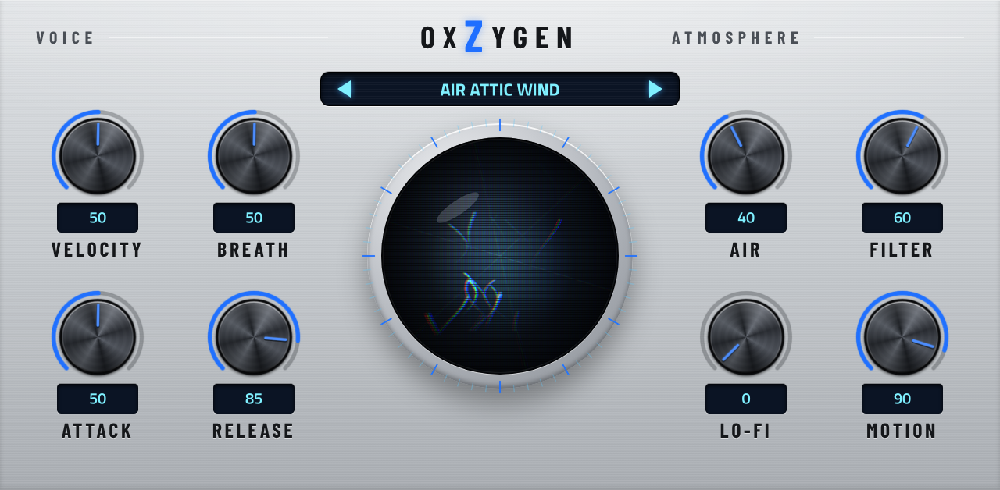
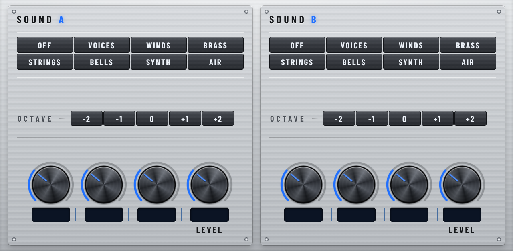
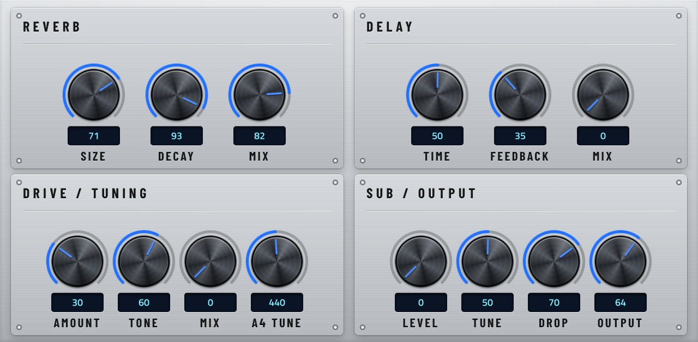

# OXZYGEN

A dark, cinematic VST2 instrument for Akai MPC standalone units: choirs, vowels and sung "doo"s, flutes, reeds, brass,
atmospheric strings, bells, Juno-style synths, soundscapes and textures, with a CRT crystal-ball orb that reacts as you play.



| Sound page | FX page |
|---|---|
|  |  |

- Two sound slots: pick a category (Voices, Winds, Brass, Strings, Bells, Synth, Air), then one of 22 sounds
- Player page: Velocity, Breath, Attack, Release, Air, Filter (resonant), Lo-Fi, Motion; the mod wheel works on every sound
- FX: reverb, ping-pong delay, drive, and a gliding sub
- 96 presets tagged by category (VOX, WND, BRS, STR, BEL, SYN, AIR), including late-night R&B and horror/film-score sets
- Gen1 (MPC OS 3.x and 2.x) and Gen2; all samples CC0 ([CREDITS.md](CREDITS.md)), code MIT ([LICENSE](LICENSE))

## Install

1. Download the zip for your MPC from the [latest release](https://github.com/3dthc/OxZygen/releases/latest):

   | Zip | For |
   |---|---|
   | `OxZygen-<version>-mpc-armv7.zip` | **Gen1**: MPC Live, Live II, One, X, Force on **MPC OS 3.x** |
   | `OxZygen-<version>-mpc-armv7-os2.zip` | the same Gen1 devices still on **MPC OS 2.x** |
   | `OxZygen-<version>-mpc-aarch64.zip` | **Gen2**: MPC Live III and the other 64-bit models (MPC OS 3.x) |

2. Install it with your MPC plugin manager, or unzip it and follow `INSTALL.md` inside.
3. On the MPC, add a plugin track and pick **OxZygen**. Presets are in the PRESET menu, grouped by tag.

Needs about 130 MB free on the internal drive; OxZygen uses about 131 MB of RAM once loaded. Tested on an MPC Live II
(MPC OS 3.10). The OS 2.x and Gen2 builds haven't been tried on those units yet, so reports are welcome in Issues.

## Pages

- **Player**: Velocity, Breath, Attack, Release on the left; Air, Filter, Lo-Fi, Motion on the right; the orb in the middle.
  The mod wheel adds movement on every sound (vibrato, drift, filter, shimmer).
- **Sound**: two slots. Pick a category, then a sound, an octave, and its three knobs (their names follow the sound) and Level.
- **FX**: reverb, ping-pong delay, drive, and a sub that follows the lowest note (Drop sets how it slides in), plus Output.

## Credits and license

Every sample is CC0 (public domain); sources are listed in [CREDITS.md](CREDITS.md). The code is MIT ([LICENSE](LICENSE)).
Built with the [MPC VST toolchain](https://github.com/open-mpc/mpc-vst-plugins).

## Building it yourself (Ubuntu / WSL)

Needs the toolchain checked out at `~/mpc-vst-plugins` (or set `MPC_VST`) and Docker running.

```bash
./build.sh            # OxZygen: Gen1 (OS 3 and OS 2 zips) and Gen2, into dist/
./build.sh sdtest     # the SD card access test plugin
```

This builds, runs the offline test, and writes the three zips to `dist/`. In WSL it also copies them to your
Windows Desktop. The first build downloads the toolchain's build images, which takes a few minutes once.

The skin artwork is pre-rendered and committed. To change the design, edit `vst/skin/make_skin.py` and run
`python3 vst/skin/make_skin.py` (needs Python with Playwright and Pillow), then build.

## Layout
- `vst/`: the plugin: `engine.c` (two sound slots and the effects), `make_presets.py` (writes `presets.json`), `params.json` (parameter order is fixed; saved
  projects depend on it; new parameters go at the end), `skin/make_skin.py` (all skin artwork and `layout.conf`)
- `vst/data/`: the prepared samples the plugin ships with (131 MB, CC0; made by `samples/prepare.py`)
- `tests/sdtest/`: SD card access test plugin
- `samples/`: fetch the CC0 sources, trim them (`trim.sh`) and prepare them for the engine (`prepare.py`: pitch,
  seamless loops, levels)
- `docs/PLAN.md`: version history and device budget
