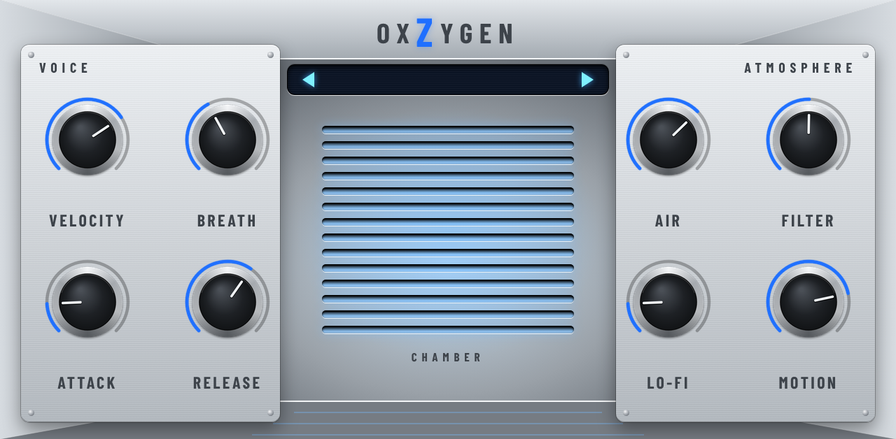
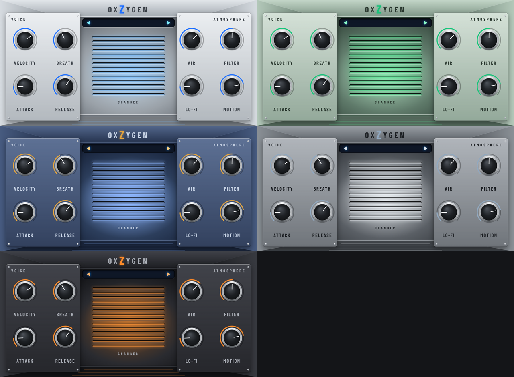
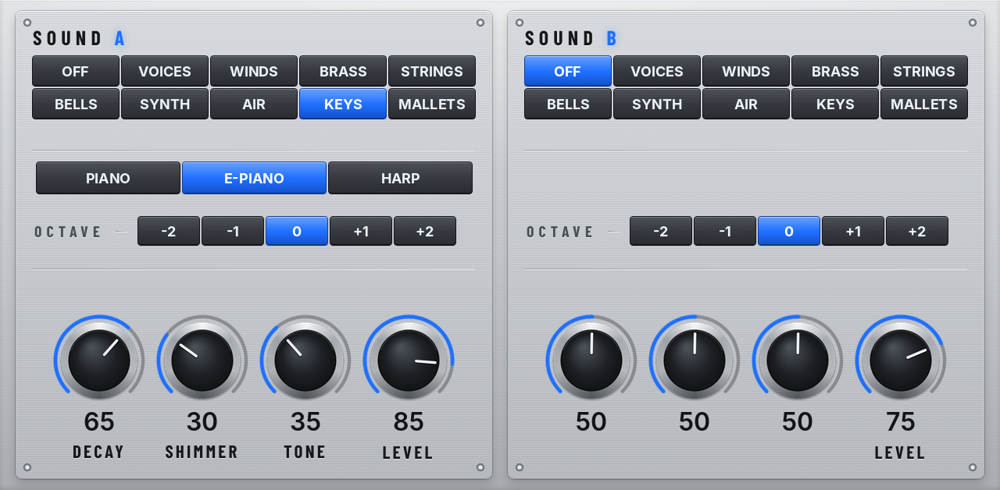
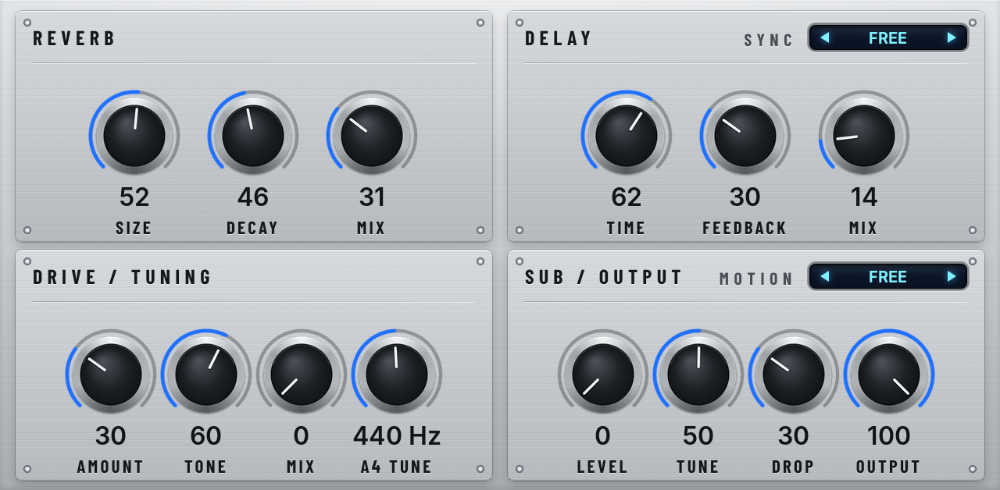
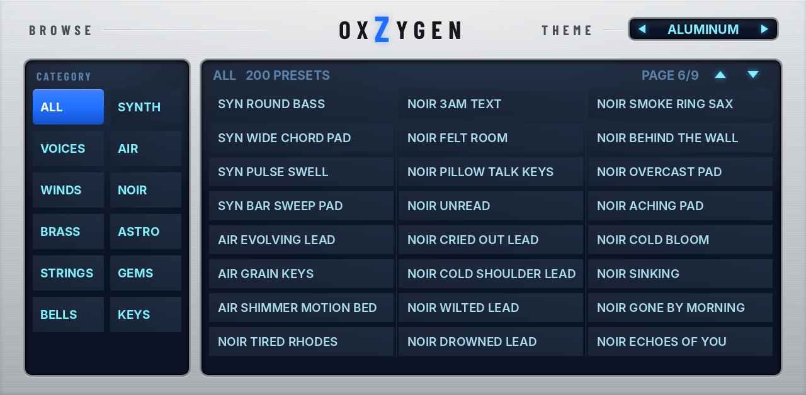

# OxZygen v0.8.0

## What's new
- **New Player page: the chamber.** The main page is now a metal chamber: the eight knobs sit on two wall panels, and the vents on the back wall glow with the sound (brighter as you play louder, fading out when you stop). Replaces the orb.
- **New knobs on every page:** brushed aluminium with a black cap and a white pointer, on Player, Sound and FX; the values sit as plain text under each knob, without the boxes (near-black and a little bigger on Aluminum, so they read from a distance).
- **Cleaner displays:** the dark screens (preset strip, Browse lists, theme and sync pickers) are now tinted glass in a metal bezel, without the scanlines.
- **Two new themes:** Graphite (dark gunmetal, white glow) and Nebula (charcoal with an orange glow), alongside Aluminum, Green and Navy. Pick one on Browse; projects keep the theme they were saved with.

## Screenshots

| Sound | FX |
|---|---|
|  |  |

